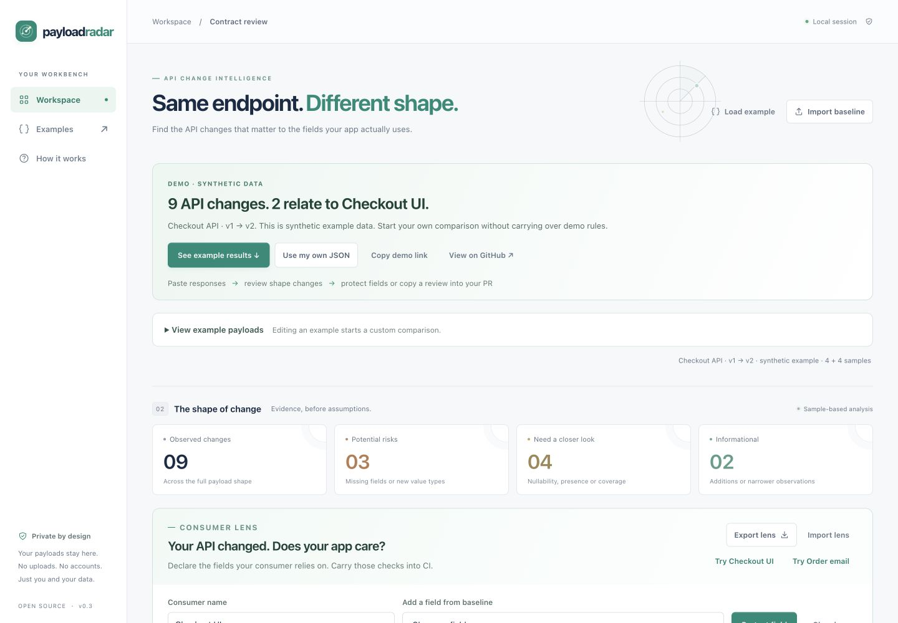

<p align="center"></p>
<h1 align="center">Payload Radar</h1>
<p align="center"><strong>Your API changed. Does your app care?</strong></p>
<p align="center">Consumer Lens + JSON drift inspector · Browser + CLI · Zero dependencies · MIT</p>
<p align="center">English · <a href="README.zh-CN.md">简体中文</a></p>
<p align="center"><a href="https://qsxustc.github.io/payload-radar/?lens=checkout#consumer-panel"><strong>Try the interactive review</strong></a> · <a href="https://github.com/qsxustc/payload-radar">GitHub</a> · <a href="https://github.com/qsxustc/payload-radar/actions/workflows/ci.yml">CI</a></p>

A payload can drift in nine places while your checkout only depends on two fields. **Consumer Lens** lets you select those fields, state the types and presence your code needs, and check candidate samples against that small, portable set of rules.

Pick `total` and `items[].quantity` as required numbers. A changed shipment field stays outside your focus; `total: "84.50"` fails your selected rule. Export a value-free `.lens.json` file, commit it next to your code, and run the same check in CI—with no baseline payload, backend, API key or dependencies.

Open a ready-made review, see the relevant failures immediately, then choose **Use my own JSON**. Each side automatically detects JSON or JSON Lines, so a pretty-printed response can be compared directly with a JSONL sample set. **Copy review summary** gives you a compact Markdown review for a pull request, with structural findings and consumer checks but no raw sample values.



## Try it in a minute

Open the [interactive checkout review](https://qsxustc.github.io/payload-radar/?lens=checkout#consumer-panel). The synthetic example is already compared, its payload editors start collapsed, and the Checkout UI lens focuses nine structural findings down to two relevant paths. **See example results** takes you to the review; **View example payloads** opens the inputs when you want the details.

To try an actual response, choose **Use my own JSON**, paste or import the two sides, and compare. Untouched example rules are removed so checkout assumptions do not follow your own data. Rules you explicitly edited or imported are retained. Each editor has its own **Auto detect / JSON / JSON Lines** control and shows the detected format after comparison.

Or run it locally:

```sh
git clone https://github.com/qsxustc/payload-radar.git
cd payload-radar
npm run dev
```

Open **http://127.0.0.1:5190**. Requires **Node.js 20 or newer**; there is no dependency installation step. Use **Examples** for a webhook edge case or a release whose values change while its shape stays the same.

You can also run the CLI immediately:

```sh
node bin/payload-radar.js \
  examples/checkout-before.jsonl examples/checkout-after.jsonl \
  --format jsonl
```

## From noisy drift to a consumer check

1. Choose **Use my own JSON** in the [workbench](https://qsxustc.github.io/payload-radar/?lens=checkout#results), then paste or import baseline and candidate samples. Browser format detection runs independently on each side.
2. In **Consumer Lens**, select only fields the consuming code reads. Baseline observations help you start; review the allowed types and whether each field is required.
3. Inspect candidate violations and focus the drift list on related paths. A container rule checks that container's type; add child rules for child fields you depend on.
4. Export the `.lens.json` file. It contains the lens name and explicit rules, without sample values or the complete inferred baseline shape. Import it in another session, or commit it for CI.

Already have a lens? Import it and load **only the candidate**; the baseline can stay empty. **Clear inputs** keeps rules you edited or imported, so you can check a new response without rebuilding them. Untouched demo presets are cleared when you start using your own data. Baseline/candidate drift is available when both sides are loaded; candidate-only mode reports the consumer check. Markdown and JSON review exports include that check.

After downloading a lens from the browser, check a new payload with one command:

```sh
node bin/payload-radar.js check consumer.lens.json candidate.jsonl --format jsonl
```

For a reproducible example included in the repository:

```sh
node bin/payload-radar.js check \
  examples/checkout.lens.json examples/checkout-after.jsonl \
  --format jsonl --output checkout-review.md
# Writes the report, then exits 1: the candidate violates a selected rule.
```

**Optional means a field may be missing.** A present `null` still fails unless `null` is an allowed type. An optional field never observed at all is marked **review**. Empty arrays provide no item observations: an item rule with no observed values returns **review**, without inventing missing children. The default gate fails on observed violations; use `--fail-on review` to also fail when a rule has no observations.

A passing lens means these candidate samples met your chosen rules. It does not prove every future response, the rest of the payload, or the complete API contract is compatible.

## Take the review into a pull request

After comparing your samples, choose **Copy review summary**. The compact Markdown includes sample counts, severity totals, structural paths and any explicit consumer-check results. It leaves out raw payload values. Paste it into your pull request or issue yourself; the app does not post anything or upload the review.

If clipboard access is unavailable, a dialog selects the same text for manual copying. **Copy demo link** shares only a built-in synthetic example. Your payloads and lens contents are never encoded into that URL. Names and structural paths may still be sensitive, so review copied or downloaded text before sharing it.

## What you get

- **A quick first review:** a ready-made synthetic result, collapsed example inputs, and an explicit route to your own JSON.
- **Independent format detection:** mix JSON and JSON Lines between sides, see what was detected, and override either side when needed.
- **Copyable review context:** a compact value-free Markdown summary for your PR, with a manual-copy fallback.
- **Consumer Lens:** select dependent paths, edit allowed types and required presence, inspect candidate rule results, and export/import portable value-free rules.
- **Structural findings:** missing observed fields, new fields, new value types, first-observed nulls, presence shifts and empty-array evidence gaps.
- **Evidence you can inspect:** select a finding to see observed values and absence locations, with sample numbers and paths. The inspector displays up to six observations per side.
- **A focused review:** severity filters, path search, before/after presence counts, and coverage notes.
- **Portable exports:** Markdown review, machine-readable JSON findings, and a JSON Schema draft inferred from the candidate samples.
- **One shared engine:** the browser, CLI and programmatic API use the same dependency-free ES module.
- **Local processing:** no payload upload, analytics, API keys, third-party scripts or browser persistence.

## Understand the input format

The browser defaults to **Auto detect independently on each side**. It first reads the entire input as one JSON document. Only a JSON syntax failure triggers a JSON Lines attempt; safety-limit and non-finite-number failures remain errors. Each editor can explicitly override the format. Files must contain UTF-8 text.

| Format | Meaning | Example |
| --- | --- | --- |
| JSON | One complete document is one sample, even if it is an array | `[{"id":1},{"id":2}]` is one array sample |
| JSONL / JSON Lines | Each nonempty line is one complete JSON sample | Two lines containing `{"id":1}` and `{"id":2}` are two object samples |

Blank JSONL lines are ignored. Pretty-printed multiline JSON is detected as JSON; a single valid JSONL line is detected as one JSON document with the same sample meaning. A top-level array stays one document in Auto mode. **CLI `--format` remains `json|jsonl` and applies to both diff inputs**; its default is still `json`. Browser Auto detection does not change CLI or core-engine parsing semantics.

Input limits are **2 MiB per side**, **1,000 top-level samples**, **64 nesting levels**, and **50,000 visited values per side**. Large inputs should be reduced to a representative subset.

Field names are limited to **1,024 UTF-16 code units** each. A cumulative structural path is limited to **4,096 UTF-16 code units**, counting each property name plus one separator and each array-item step as two units. Across all findings, the combined UTF-8 size of the individually JSON-encoded `{ id, path, pointer, tokens }` objects must not exceed **2 MiB**. This is a budget for finding locations, not a limit on the entire exported report. Shorten field names or compare smaller sample groups when a limit is reached.

Object property presence is counted within observed objects at its immediate parent. Array items are pooled across all samples; they are not matched by ID or position. For example, three objects in one array contribute three object observations to the fields inside that array.

## CLI

```text
payload-radar <before-file> <after-file> [options]
payload-radar check <consumer.lens.json> <candidate-file> [options]

--format json|jsonl             default: json
--report markdown|json          default: markdown
--fail-on risk|review|any|none   diff default: none; check default: risk
--schema                       export the candidate JSON Schema draft (diff only)
--output <path>                write a new file; existing files are never overwritten
--help, -h
```

Use `node bin/payload-radar.js` from a clone. `npm link` optionally makes the `payload-radar` command available locally; this project does not require a published npm package.

```sh
# A machine-readable report
node bin/payload-radar.js before.json after.json --report json

# A CI gate: exit 1 when a potential risk was observed
node bin/payload-radar.js before.json after.json --fail-on risk

# Save the candidate schema draft to a new file
node bin/payload-radar.js before.json after.json --schema --output candidate.schema.json

# Save a Markdown report and gate risk or review findings
node bin/payload-radar.js before.json after.json --fail-on review --output review.md
```

In **diff mode**, `--fail-on review` includes both `risk` and `review`; `any` includes informational findings too. In **check mode**, the default `risk` gate fails on rule violations; `review` and `any` also fail when a rule has no observed values. `none` disables either gate. Reports are written before evaluating the gate, so a failing gate still leaves its report available. `--schema` cannot be combined with an explicit `--report`. Schema mode still takes both input files and applies the requested comparison gate. Check mode rejects `--schema`; its `--format` applies to the candidate only, because a lens is always JSON. Use `-- check after.json` to compare a baseline file literally named `check`.

Exit codes: **0** for success or a passing gate, **1** for a requested gate with matching findings, **2** for invalid arguments, invalid inputs or I/O errors. Candidate and diff input files are limited to 2 MiB; lens files are limited to 256 KiB. Input files must be regular files; final file symlinks are rejected. Parent directory symlinks such as macOS `/tmp` are supported. Output files are created exclusively and cannot overwrite either input or an existing output.

## GitHub Actions: use the lens in your app's CI

Export a lens into your application's repository and provide candidate samples checked out or generated by an earlier step. Save a workflow such as `.github/workflows/payload-check.yml`:

```yaml
name: Check consumed payload fields
on: [push, pull_request]
permissions:
  contents: read
jobs:
  consumer-check:
    runs-on: ubuntu-latest
    steps:
      - uses: actions/checkout@v4
      - uses: qsxustc/payload-radar@v0.3.0
        with:
          lens: contracts/checkout.lens.json
          candidate: fixtures/checkout-after.jsonl
          format: jsonl
```

Paths are relative to your checked-out workspace. The action sets up Node.js 22 and runs the shared CLI directly from its action checkout; you do not need to clone Payload Radar or install dependencies in your app. It fails on observed rule violations by default. Optional inputs are `fail-on` (`risk`, `review`, `any`, `none`), `report` (`markdown` or `json`) and `output` (a **new** local report path). Reports go to the job log unless `output` is provided. The action checks local fixtures; fetching candidate payloads belongs in your own earlier workflow step.

## Use the engine

```js
import {
  parseInput, inferShape, compareShapes, toJSONSchema, toMarkdown,
} from './src/core.js';

const beforeSamples = parseInput('{"total":84.5}', 'json');
const afterSamples = parseInput('{"total":"84.50"}', 'json');
const before = inferShape(beforeSamples);
const after = inferShape(afterSamples);
const changes = compareShapes(before, after);

console.log(changes);
console.log(toJSONSchema(after));
console.log(toMarkdown({
  beforeName: 'before.json', afterName: 'after.json',
  beforeSamples: beforeSamples.length, afterSamples: afterSamples.length,
  changes,
}));
```

Findings include a human-readable `path`, a pointer-like `pointer`, typed `tokens`, a severity, a kind, observed types and presence counts. A `null` token represents an array item; string tokens are literal property names. For traversing data, prefer `tokens`: display paths and array wildcard pointers are not concrete JSON Pointers. See [architecture](docs/architecture.md) for details.

### Consumer Lens API

```js
import { parseInput } from './src/core.js';
import { normalizeLens, checkLens, serializeLens, lensMarkdown } from './src/consumer.js';

const lens = normalizeLens({
  kind: 'payload-radar-consumer',
  schemaVersion: 1,
  name: 'Checkout',
  rules: [
    { tokens: ['total'], types: ['number'], required: true },
    { tokens: ['items', null, 'quantity'], types: ['number'], required: true },
  ],
});
const report = checkLens(lens, parseInput('{"total":"84.50"}', 'json'));
console.log(report.status); // fail
console.log(lensMarkdown(report));
console.log(serializeLens(lens)); // no raw sample values or baseline shape
```

For package imports, the main entry remains `payload-radar`; the consumer module is also exported as `payload-radar/consumer`. A lens supports the six JSON types (`array`, `boolean`, `null`, `number`, `object`, `string`), at most **100 rules**, and a name of at most **80 UTF-16 code units**. Typed tokens use the same property and array-item representation as findings. `parseLens` validates imported text; `normalizeLens` validates programmatic input. The [architecture](docs/architecture.md) documents path limits and check semantics.

## Know the limits

**Diff results are sample inference; Consumer Lens rules are explicit assumptions you choose, not proof of an API contract.** A missing field may simply be absent from your chosen examples. An unchanged result does not prove compatibility. Severity labels prioritize human review; they are not a guarantee that a consumer will break or remain safe.

- Empty arrays establish the `array` type but provide no evidence about their items. Reduced item evidence is surfaced for review instead of pretending it proves a field removal.
- Value-only changes, enums, formats, number ranges, tuple positions, discriminators and cross-field rules are outside this release's analysis.
- Numbers use JavaScript number precision, and all finite numbers share the `number` type. Large integer identifiers should be encoded as strings when exact precision matters. The tool does not infer `integer` separately.
- Generated JSON Schema describes observed candidate samples. Fields seen in every parent object are marked `required`; that is an observation, not proof they are required by the API. Additional properties remain allowed. Review the draft before using it as a contract.
- The page and assets are fetched from the hosting provider, but payload content and lenses stay in the current tab. Neither is persisted in browser storage. Refreshing closes that in-memory workspace; export a lens to keep it and import it later. Exports omit raw sample values, but field names, file names and structural findings can still be sensitive.

## Develop and deploy

```sh
npm test            # Node's built-in test runner
npm run build       # writes a static app to dist/
npm run preview     # serves dist/ on http://127.0.0.1:5190
```

Use `npm run dev -- --port 5191` or `npm run preview -- --port 5191` to select another port. The development server binds to loopback and serves only app assets. Builds copy `index.html`, `src/`, `assets/` and `examples/`; local metadata and CLI code are not deployed. Built CSS/JavaScript entry URLs and relative static module imports carry one stable content-based build ID, so a refreshed deployment loads a consistent module graph. Source files stay unchanged.

The included [Pages workflow](.github/workflows/pages.yml) tests and builds on `main` pushes or manual dispatch, then deploys `dist/`. Enable **GitHub Actions** as the Pages source in repository settings. All asset paths are relative, so the static app can also be hosted under a subdirectory or on another static host.

See [CONTRIBUTING](CONTRIBUTING.md), [security reporting](SECURITY.md), [architecture](docs/architecture.md), [changelog](CHANGELOG.md), and [launch notes](docs/launch.md). Licensed under [MIT](LICENSE).

If Payload Radar makes a release review easier, a star helps other developers discover it. Bug reports with small synthetic examples are especially welcome.
