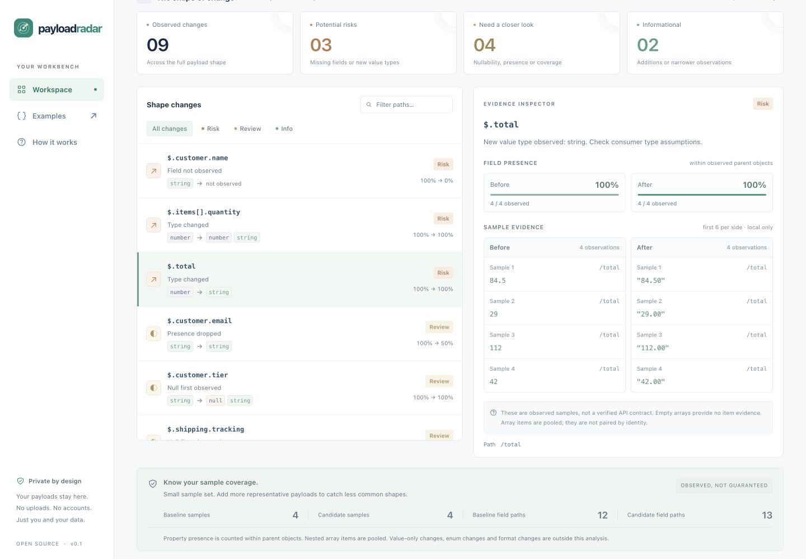

<p align="center"></p>
<h1 align="center">Payload Radar</h1>
<p align="center"><strong>JSON 变了，先看哪些变化可能让代码出错。</strong></p>
<p align="center">本地优先的 JSON 结构检查器 · 浏览器 + CLI · 零依赖 · MIT</p>
<p align="center"><a href="README.md">English</a> · 简体中文</p>
<p align="center"><a href="https://qsxustc.github.io/payload-radar/"><strong>立即体验在线演示</strong></a> · <a href="https://github.com/qsxustc/payload-radar">GitHub 仓库</a> · <a href="https://github.com/qsxustc/payload-radar/actions/workflows/ci.yml">CI</a></p>

把 API 更新前后的 JSON 或 JSON Lines 样本放在一起，快速发现新类型、未再出现的字段、空值和字段出现率变化，并查看每项发现对应的本地样本证据。

订单金额从 `84.5` 变成 `"84.50"`，可能会破坏计算；订单 ID 换了一个值，通常无需关注。Payload Radar 专注于这类结构变化，帮助你从大量数值差异中找出真正需要审查的内容。



## 一分钟体验

克隆此仓库后运行：

```sh
git clone https://github.com/qsxustc/payload-radar.git
cd payload-radar
npm run dev
```

打开 **http://127.0.0.1:5190**。需要 **Node.js 20 或更新版本**，无需安装任何依赖。应用启动后会直接加载合成的结账 API 示例。点击 **Examples**，还可以体验 Webhook 边界情况和“值改变但结构不变”的版本对比。

命令行可以直接运行：

```sh
node bin/payload-radar.js \
  examples/checkout-before.jsonl examples/checkout-after.jsonl \
  --format jsonl
```

## 已实现的功能

- **结构变化检查**：未再观察到的字段、新字段、新类型、首次出现的 `null`、字段出现率变化，以及空数组带来的证据缺口。
- **可检查的样本证据**：点击变化项，查看原始观察值、字段缺失位置、样本编号和路径。每侧最多展示六条观察记录。
- **便于审查的界面**：按严重程度筛选、搜索路径、查看前后出现次数和样本覆盖提示。
- **可携带的输出**：导出 Markdown 报告、JSON 变化报告和根据候选样本推断的 JSON Schema 草稿。
- **浏览器与 CLI 共用引擎**：相同的零依赖 ES module 可直接供代码调用。
- **本地处理**：无数据上传、分析埋点、API Key、第三方脚本或浏览器持久化存储。

## 输入格式

两侧共用一种输入格式，文件使用 UTF-8 编码。

| 格式 | 含义 | 示例 |
| --- | --- | --- |
| JSON | 一个完整文档就是一个样本，顶层数组也不例外 | `[{"id":1},{"id":2}]` 是一个数组样本 |
| JSONL / JSON Lines | 每个非空行是一个完整 JSON 样本 | 两行分别写 `{"id":1}` 和 `{"id":2}`，就是两个对象样本 |

JSONL 会忽略空白行。跨行排版的 JSON 对象应使用 JSON 模式。每侧限制为 **2 MiB**、**1,000 个顶层样本**、**64 层嵌套**和 **50,000 个被访问的值**。数据较大时，请挑选有代表性的子集。

每个字段名最多 **1,024 个 UTF-16 码元**。结构路径的累计长度最多 **4,096 个 UTF-16 码元**：每个属性按字段名长度加一个分隔符计算，每次数组元素步骤计两个码元。所有发现中，将每项的 `{ id, path, pointer, tokens }` 对象分别 JSON 编码后，其 UTF-8 大小合计不得超过 **2 MiB**。此限制针对变化位置元数据，不是整个导出报告的大小上限。遇到限制时，请缩短字段名或分组对比更小的样本集合。

字段出现率的分母是其直接父节点中观察到的对象数量。数组元素会跨样本合并统计，不按 ID 或下标匹配。例如，一个数组中的三个对象，会为数组内部字段贡献三次对象观察。

## 命令行

```text
payload-radar <before-file> <after-file> [options]

--format json|jsonl             默认 json
--report markdown|json          默认 markdown
--fail-on risk|review|any|none   默认 none
--schema                       导出候选样本的 JSON Schema 草稿
--output <path>                仅创建新文件，不覆盖已有文件
--help, -h
```

在仓库内使用 `node bin/payload-radar.js` 即可。也可自行执行 `npm link`，在本地启用 `payload-radar` 命令；使用本项目不需要 npm 平台上的发布包。

```sh
# 输出机器可读的报告
node bin/payload-radar.js before.json after.json --report json

# CI 检查：发现潜在风险时返回退出码 1
node bin/payload-radar.js before.json after.json --fail-on risk

# 将候选 Schema 草稿保存到新文件
node bin/payload-radar.js before.json after.json --schema --output candidate.schema.json

# 保存 Markdown 报告，并对 risk 或 review 级别触发失败
node bin/payload-radar.js before.json after.json --fail-on review --output review.md
```

`--fail-on review` 同时包含 `risk` 与 `review`，`any` 还包含信息项。工具先输出报告，再判断是否触发失败，因此 CI 返回 1 时仍能保留报告。`--schema` 与显式指定的 `--report` 互斥。Schema 模式仍接收两个输入文件，并应用所选的对比检查条件。

退出码：**0** 表示成功或检查通过；**1** 表示满足用户指定的失败条件；**2** 表示参数、输入或文件操作错误。输入必须是普通文件，最终文件本身不能是符号链接；支持父目录中的符号链接，例如 macOS 的 `/tmp`。输出采用排他创建方式，不能覆盖任一输入或已有输出文件。

## 直接调用引擎

```js
import {
  parseInput, inferShape, compareShapes, toJSONSchema, toMarkdown,
} from './src/core.js';

const beforeSamples = parseInput('{"total":84.5}', 'json');
const afterSamples = parseInput('{"total":"84.50"}', 'json');
const before = inferShape(beforeSamples);
const after = inferShape(afterSamples);
const changes = compareShapes(before, after);

console.log(changes);
console.log(toJSONSchema(after));
console.log(toMarkdown({
  beforeName: 'before.json', afterName: 'after.json',
  beforeSamples: beforeSamples.length, afterSamples: afterSamples.length,
  changes,
}));
```

每项发现包含可读的 `path`、类似指针的 `pointer`、带类型的 `tokens`、严重程度、变化种类、观察类型和出现次数。`tokens` 中的 `null` 代表数组元素，字符串代表实际属性名。程序遍历时优先使用 `tokens`：展示路径和包含数组通配符的指针不是具体的 JSON Pointer。详见[架构说明](docs/architecture.md)。

## 适用边界

**这是从样本推断结构，不是验证过的 API 契约。** 字段没有出现，可能只是这批样本没有覆盖到。没有发现变化也不等于证明兼容。严重程度用于安排人工审查优先级，不保证某个调用方一定会出错或一定安全。

- 空数组只证明该位置出现过 `array`，不能提供元素类型证据。元素证据减少时会提示审查，不会假定已经证明字段删除。
- 本版本不分析纯数值变化、枚举、格式、数值范围、元组位置、鉴别字段或跨字段规则。
- 数字使用 JavaScript 数字精度，所有有限数字统一归为 `number`。需要精确保留的大整数 ID 应使用字符串。本工具不会单独推断 `integer`。
- 生成的 JSON Schema 仅描述候选样本。在所有父对象中均出现的属性会被列入 `required`，但这不代表 API 契约要求该字段。允许额外属性；用于正式契约前必须审查。
- 托管方会收到正常页面和静态资源请求，但载荷内容只保留在当前标签页内存中，刷新后工作区会清空。导出不含原始样本值，但字段名、文件名和结构信息本身也可能敏感。

## 开发与部署

```sh
npm test            # 使用 Node 内置测试框架
npm run build       # 生成静态应用到 dist/
npm run preview     # 在 http://127.0.0.1:5190 预览 dist/
```

指定其他端口：`npm run dev -- --port 5191` 或 `npm run preview -- --port 5191`。开发服务器只监听回环地址，仅提供应用资源。构建只复制 `index.html`、`src/`、`assets/` 和 `examples/`，不部署本地元数据与 CLI 代码。

自带的 [Pages 工作流](.github/workflows/pages.yml) 会在 `main` 推送或手动触发时测试、构建并部署 `dist/`。在仓库设置中将 Pages 来源设为 **GitHub Actions**。资源路径均为相对路径，也可部署在子路径或其他静态托管平台。

更多信息：[贡献指南](CONTRIBUTING.md)、[安全问题报告](SECURITY.md)、[架构](docs/architecture.md)、[更新记录](CHANGELOG.md)、[发布说明素材](docs/launch.md)。使用 [MIT](LICENSE) 许可证。
